# NexDesk Web

The Angular client for **NexDesk**, a multi-tenant help desk and SLA management SaaS. One app serves
three audiences: support teams in their workspace (`/app`), their customers in a branded help centre
(`/portal/<workspace>`), and the people who run NexDesk in the platform console (`/admin`).

The API, the architecture diagrams and the data model live in
[nexdesk-api](https://github.com/mahmoudadel810/nexdesk-api).

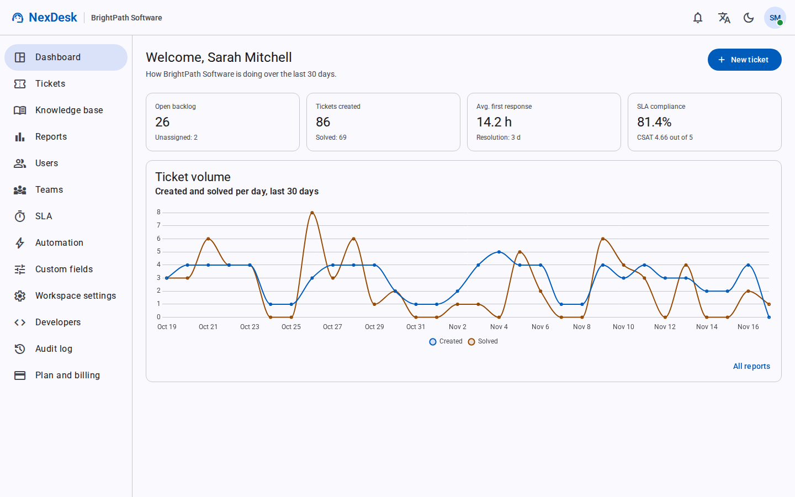

## What's inside

- **Agent workspace:** a ticket inbox with filters, saved views, bulk actions and live updates; a ticket
  page with replies, internal notes, attachments, @mention suggestions, watchers, SLA countdowns, custom
  fields and the full activity timeline.
- **Setup and administration:** a first-run wizard, users and invitations, teams, SLA policies with
  business hours and holidays, an automation rule builder, custom fields, branding, API keys and webhooks,
  the audit log, and plans and billing.
- **Reports:** charts for volume, backlog, response times, SLA compliance and satisfaction, an agent
  leaderboard and CSV export.
- **Knowledge base:** a Markdown editor for agents and a searchable public help centre.
- **Customer portal:** sign-up, requests and replies, ratings, and article suggestions while writing.
- **Notifications:** a bell with live counts over SignalR, and per-type preferences for in-app and email.
- **Platform console:** every workspace with plan and usage, suspension, revenue and sign-up charts, and the
  background job dashboard.
- **For everyone:** English and Arabic with a full right-to-left layout, light and dark themes, the
  workspace's own colour and logo, keyboard navigation, skip links and screen-reader labels.

## Screenshots

| | |
|---|---|
| 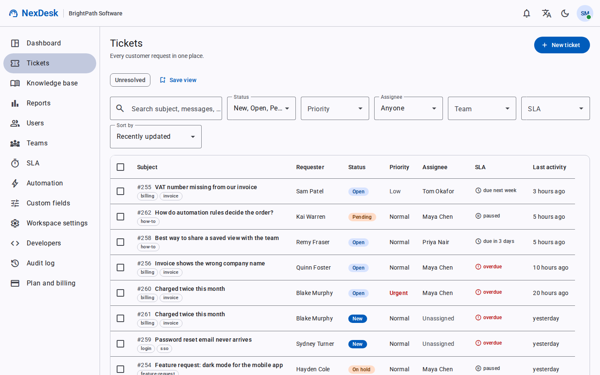 Ticket inbox | 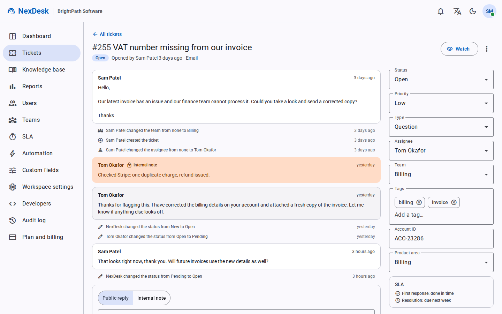 A ticket with its timeline |
| 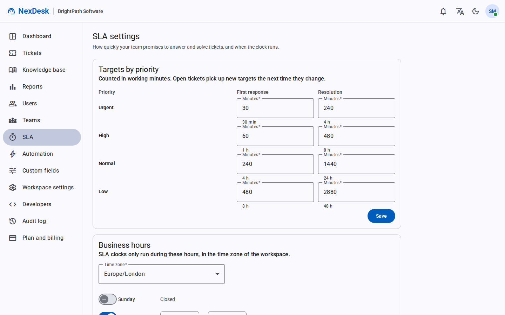 SLA policies | 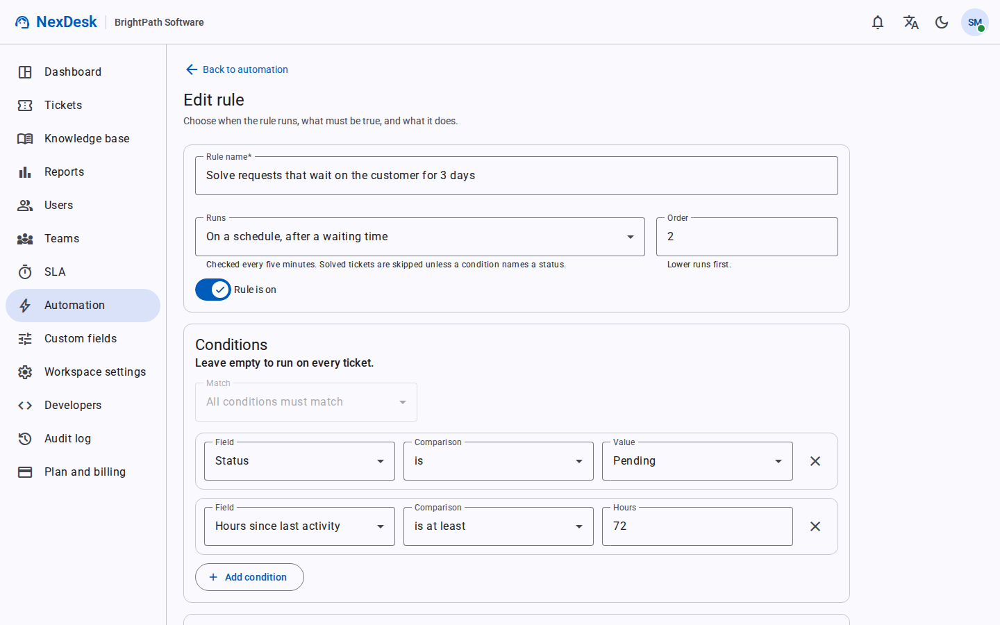 Automation rules |
| 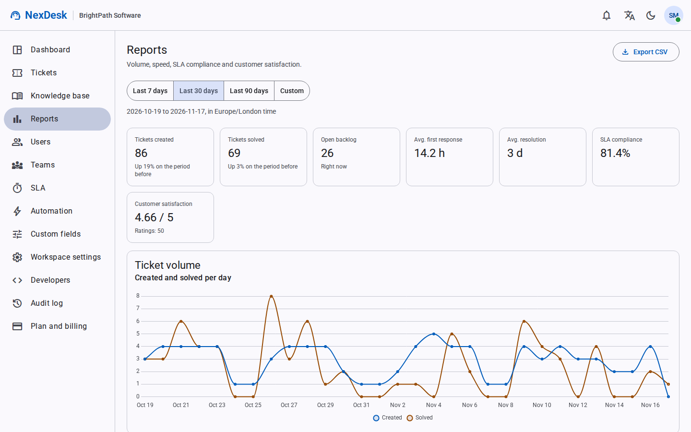 Reports | 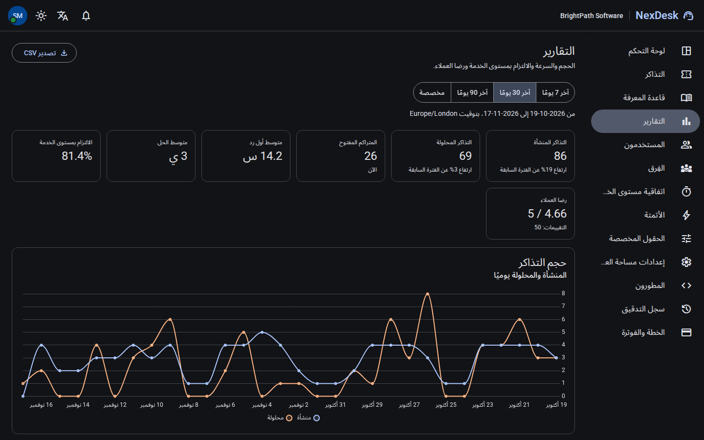 Reports in Arabic |
| 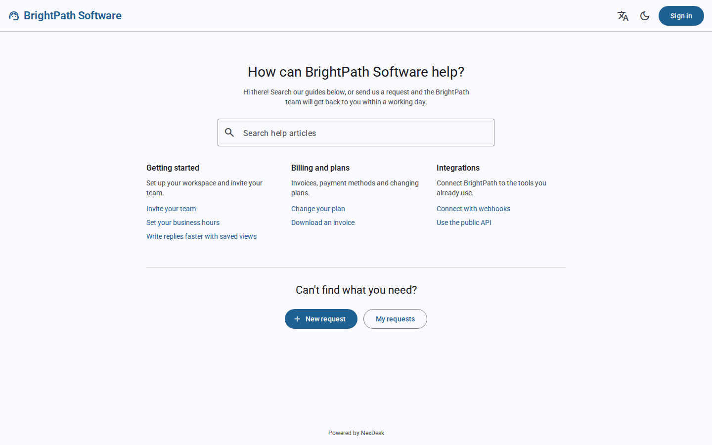 Customer help centre | 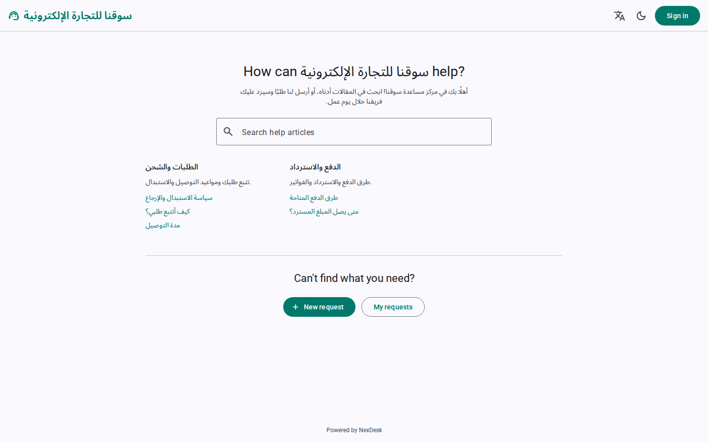 Help centre in Arabic |
| 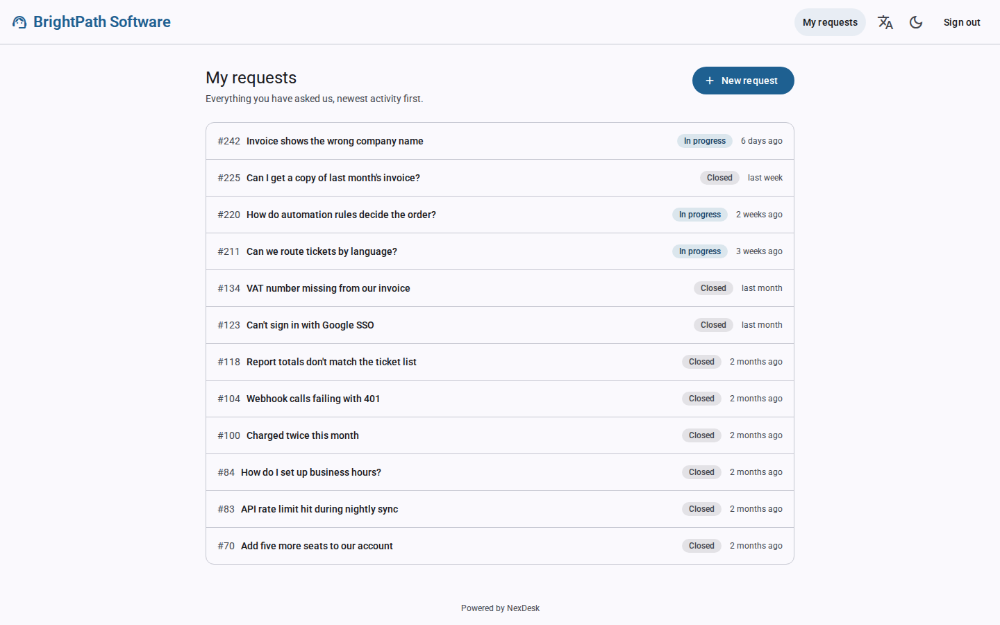 A customer's requests | 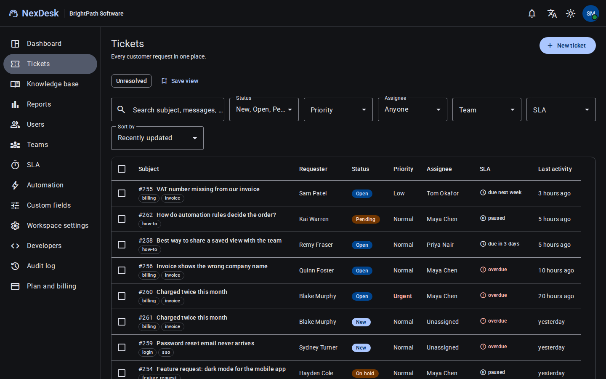 Dark theme |
| 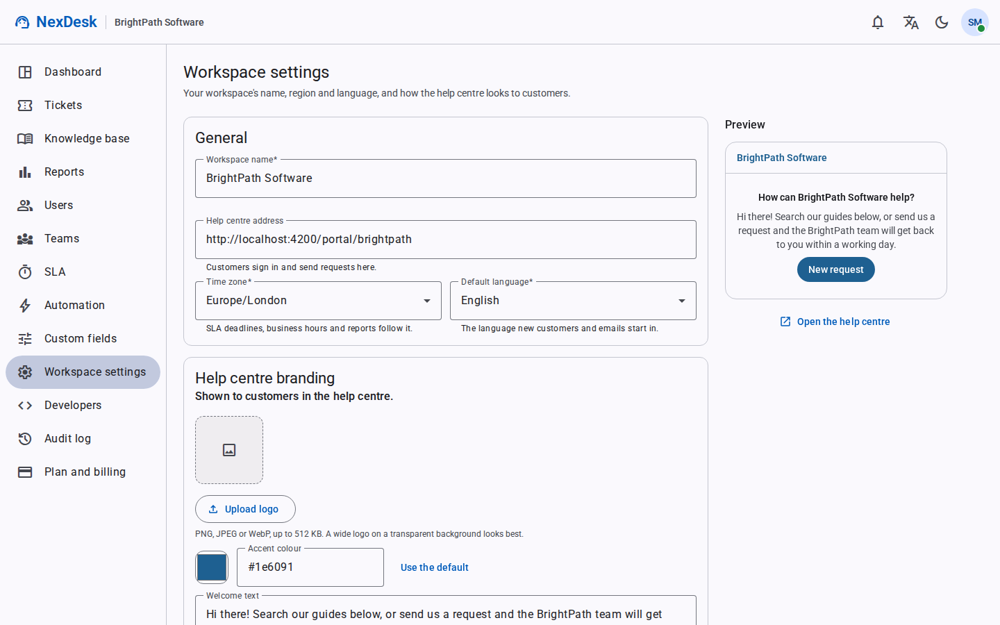 Branding and settings | 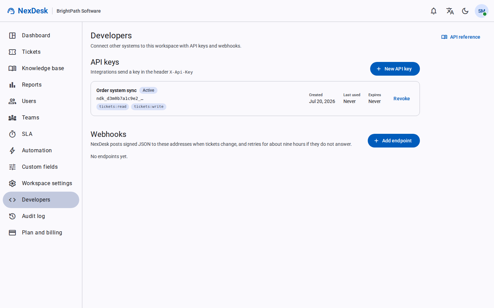 API keys and webhooks |
| 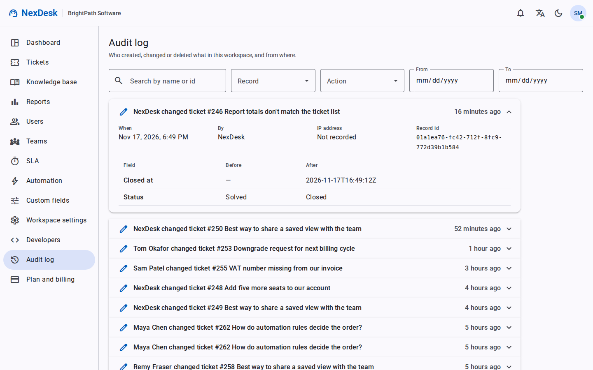 Audit log | 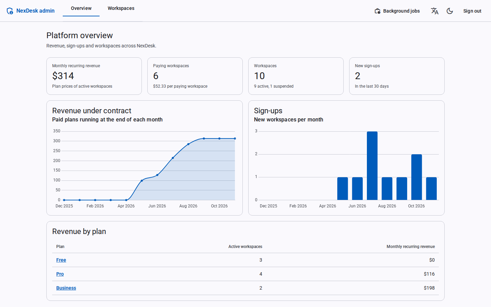 Platform console |

## Tech stack

| Area | Choice |
|------|--------|
| Framework | Angular 22: standalone components, signals, zoneless change detection |
| UI | Angular Material (M3) with a custom theme; the workspace colour is applied as design tokens |
| Real time | `@microsoft/signalr` |
| Charts | Chart.js |
| i18n | Transloco, English and Arabic, switching the whole layout to right-to-left |
| Unit tests | Vitest through the Angular unit-test builder |
| End-to-end | Playwright (Chromium) |
| Lint and format | ESLint (angular-eslint) and Prettier |

## Quick start

Prerequisites: Node.js 24 (or 22.22.3+) and the API running on `http://localhost:8080` with the demo
data seeded. The [API quick start](https://github.com/mahmoudadel810/nexdesk-api#quick-start) does both
with Docker in three commands.

```bash
npm ci
npm start
```

Open http://localhost:4200. The dev server forwards `/api` and `/hubs` to the API through
`proxy.conf.json`; change its `target` if your API runs elsewhere.

### Demo accounts

Every demo account uses the password **`NexDesk-demo-2026`**.

| Who | Email | Sign in at |
|-----|-------|------------|
| Workspace owner (BrightPath, English) | `sarah@brightpath.demo` | http://localhost:4200/auth/login |
| Agent | `maya@brightpath.demo` | http://localhost:4200/auth/login |
| Viewer | `finance@brightpath.demo` | http://localhost:4200/auth/login |
| Workspace owner (Souqna, Arabic) | `layla@souqna.demo` | http://localhost:4200/auth/login |
| Customer of BrightPath | `casey@customers.demo` | http://localhost:4200/portal/brightpath/login |
| Customer of Souqna | `ahmed@customers.demo` | http://localhost:4200/portal/souqna/login |
| Platform admin | `admin@nexdesk.demo` | http://localhost:4200/auth/login |

The [API README](https://github.com/mahmoudadel810/nexdesk-api#demo-accounts) lists every account.

### Running in Docker next to the API

With the API's `docker compose up` already running:

```bash
docker build -t nexdesk-web .
docker run --rm -p 4200:80 --network nexdesk_default nexdesk-web
```

nginx in the container serves the app and forwards `/api`, `/hubs`, the API reference (`/docs`,
`/openapi`) and the job dashboard (`/hangfire`) to `API_UPSTREAM`, which defaults to `http://api:8080`,
the API's service name on the compose network.

### Hosting on Vercel

[`vercel.json`](vercel.json) builds the app (`npm run build`, output `dist/nexdesk-web/browser`), sends
unknown paths to `index.html` for client-side routing, and rewrites `/api`, `/hubs`, `/docs`, `/openapi`
and `/hangfire` to the API on Render (`https://nexdesk-api.onrender.com`). The browser therefore talks to
one origin and the refresh-token cookie stays first-party. Change the rewrite destinations if the API
lives elsewhere.

```bash
npm i -g vercel
vercel login
vercel deploy --prod
```

Vercel rewrites do not carry WebSockets, so SignalR falls back to server-sent events or long polling on
its own. The [API README](https://github.com/mahmoudadel810/nexdesk-api#hosted-demo-supabase-render-and-vercel)
covers the database and the API.

### App links for the mobile app

`public/.well-known/assetlinks.json` and `public/.well-known/apple-app-site-association` let ticket links
(`/app/tickets/{id}`, the ones in notification emails) open in the NexDesk mobile app when it is
installed. Both Vercel (`vercel.json`) and the nginx image serve them as `application/json`.

- Android: `app.nexdesk.mobile` is signed with the upload key and `app.nexdesk.mobile.dev` with the debug
  key; their SHA-256 fingerprints are listed. Once the app is on Google Play, add the fingerprint of Play's
  app-signing key from the Play Console as well.
- iOS: `appIDs` is empty until there is an Apple developer account; then add
  `<TeamID>.app.nexdesk.mobile`.

### API URL per environment

`src/environments/environment.ts` (production) and `environment.development.ts` hold `apiUrl` and
`hubUrl`. Both are relative paths, so one build works behind any reverse proxy.

## Project layout

```
src/app/
  core/       API clients, auth (session, guards), HTTP interceptors, realtime, theme, i18n setup
  layout/     the workspace shell, notification bell, language and theme controls
  features/   workspace pages: tickets, reports, kb, users, teams, settings, profile, onboarding, auth
  portal/     the customer help centre
  admin/      the platform console
  shared/     dialogs, pipes, charts and small reusable pieces
e2e/          Playwright tests and the screenshot script
```

## Tests

| Command | What it runs |
|---------|--------------|
| `npm test` | Unit and component tests (Vitest, single run) |
| `npm run lint` | ESLint over TypeScript and templates |
| `npm run format:check` | Prettier check |
| `npm run build` | Production build into `dist/` |
| `scripts/verify.sh` | Lint, format check, unit tests and build in one go; run it before merging |
| `npm run e2e` | Playwright end-to-end tests against a running, seeded stack |
| `npm run screenshots` | Recreates `docs/screenshots/*.png` from a running, seeded stack |

### End-to-end tests

The E2E suite signs in as the demo accounts, so it needs the API with the demo data and the web app
running. It covers an agent recording a ticket, adding a note that @mentions a teammate and finding the
ticket again; the dashboard and
reports with CSV export; the help centre answering from its articles; a customer sending a request and
following it; the switch to Arabic and right-to-left; an Arabic workspace; the owner's developer tools,
audit log and branding; and the platform console.

```bash
npx playwright install chromium
npm start                  # in another terminal, or point E2E_BASE_URL at a running build
npm run e2e
```

`E2E_BASE_URL` (default `http://localhost:4200`) chooses the app to test, for example the Docker image:
`E2E_BASE_URL=http://localhost:4200 npm run e2e` after `docker run -p 4200:80 ...` above.

The suite signs in many times in a few minutes. The API allows 10 sign-ins per minute from one address
by default, so for a full run either turn request limits off or raise the sign-in limit (in the
nexdesk-api folder):

```bash
RATE_LIMITING_ENABLED=false docker compose up -d api
```

```bash
AUTH_RATE_LIMIT_PER_MINUTE=200 docker compose up -d api
```

The tests create tickets as they go. Run `npm run screenshots` on freshly seeded data, before the E2E
suite, if you want the screenshots without them.
